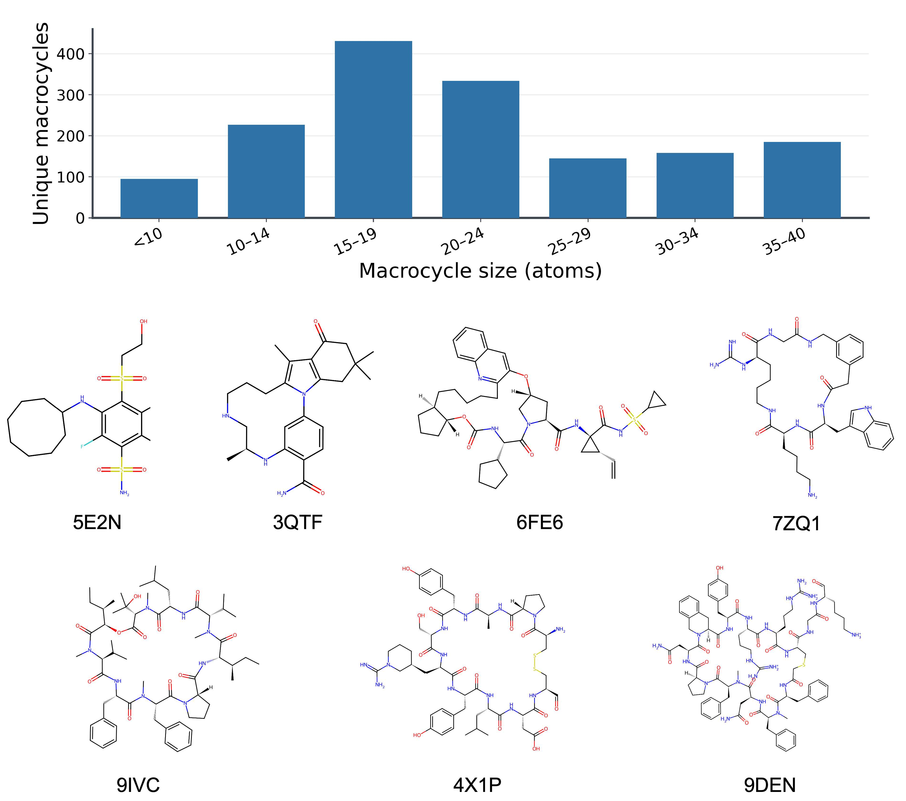
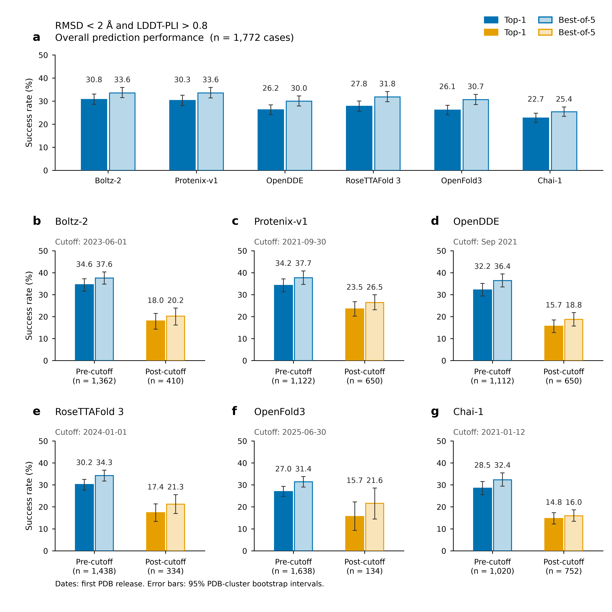

# MacroCycle-Benchmark：蛋白质–大环结构数据集与共折叠预测基准

[English](README.md) | 简体中文

MacroCycle-Benchmark 是基于 PDB 实验结构构建的蛋白质–大环结构数据集，涵盖环肽与非肽大环。通过配体化学结构重建、参考信息核验及逐例人工检查，我们将完整的大环化学结构、实验结合构象与蛋白质环境关联起来，为大环构象采样、分子对接和共折叠方法的开发与评测提供实验参照。

基于该数据集，我们评测了六种通用共折叠模型，重点考察其对新颖蛋白质–大环结合模式的泛化能力，以及输入方式、环尺寸和历史结构相似性与预测表现的关系。

**论文：** [Evaluating cofolding methods for protein–macrocycle structure prediction](https://doi.org/10.26434/chemrxiv.15012755/v1) · ChemRxiv，2026

## 项目动态

- **2026-11-25：** 研究论文在 ChemRxiv 发布。
- 数据集及案例索引已公开，索引包含 PDB 发布日期、主环尺寸分组和序列输入相关子集标记。

## 数据集概览

| 项目 | 数量或范围 |
|---|---:|
| 蛋白质–大环结合案例 | 1,861 |
| 来源 PDB 条目 | 1,686 |
| 独特大环配体 | 1,570 |
| 主环尺寸 | 8–40 个原子 |
| 序列输入候选子集 | 628 |
| 标准氨基酸环肽分析子集 | 74 |
| 论文中六模型共同评测案例 | 1,772 |

每个案例提供蛋白质结构、经过化学核验的大环配体实验结构，以及在参考 pH 7.4 下准备的质子化配体结构。

数据整理包括以下步骤：

1. **提取与筛选。** 从 PDB 实验复合物中使用团队开发的 [LigandExplorer](https://doi.org/10.1021/acs.jcim.5c02921) 提取候选配体，根据原子连接关系识别大环并筛除不符合要求的结构。
2. **化学结构重建与核验。** 在保留实验重原子坐标的同时，重建并核验配体连接关系、键级、跨残基连接和闭环键，结合 CCD 定义、PDB/mmCIF 记录及可用文献信息进行修正。
3. **结构准备与质量检查。** 生成质子化结构，进行去冗余、自动检查和逐例人工复核，核对配体结构、SMILES、元数据及蛋白质–配体对应关系。



独特大环配体的主环尺寸分布及代表性化学结构。

## 共折叠模型评测

下表为论文中六种模型在 **1,772 个共同案例**上的评测结果。各模型均以配体 **SMILES** 为输入，每个案例评价五个候选结构。

| 模型 | Top-1 成功率（%） | Best-of-5 成功率（%） |
|---|---:|---:|
| Boltz-2 | 30.8 | 33.6 |
| Protenix-v1 | 30.3 | 33.6 |
| OpenDDE | 26.2 | 30.0 |
| RoseTTAFold 3 | 27.8 | 31.8 |
| OpenFold3 | 26.1 | 30.7 |
| Chai-1 | 22.7 | 25.4 |

**成功标准：** 同一候选须同时满足结合位点叠合后的配体重原子 RMSD <2 Å，以及蛋白质–配体界面 LDDT（LDDT-PLI）>0.8。

- **Top-1：** 采用模型原生置信度排名第一的候选。
- **Best-of-5：** 五个候选中至少一个满足成功标准。这一指标依赖实验结构判定，用于衡量当前候选集合的成功覆盖能力。

以上为论文所评测模型版本和推理设置下的结果。完整配置与统计方法见论文。



论文 Figure 1：六种模型的总体预测表现及各自训练截止日期前后的表现。误差线表示按 PDB 条目聚类自助抽样得到的 95% 置信区间。

### 主要发现

- **时间外推表现下降。** 六种模型在各自训练截止日期后发布的案例中，Top-1 成功率均低于截止日期前，下降幅度为 10.7–16.5 个百分点。
- **低历史相似性体系更难预测。** 在可评估历史相似性的截止日期后案例中，最低相似性组的成功率在六种模型中均低于 8%。历史参考来自基准内相应截止日期前的实验结构。
- **序列输入改善部分环肽的预测。** 在模型内配对案例中，Boltz-2 和 RoseTTAFold 3 使用序列输入获得的已确认成功预测均多于使用 SMILES 输入，但截止日期后的预测表现仍然较低。
- **大型环的困难涉及配体构象本身。** 对于 30–40 元环，各模型 SMILES Top-1 失败预测中有 97.5%–100% 在配体单独叠合后仍有至少 2 Å 的重原子 RMSD。

这些结果表明，现有模型对新颖大环结合模式的泛化能力仍然有限。评测模型进展时，除总体成功率外，还应关注低历史相似性体系和不同环尺寸下的表现。

## 快速开始

下载仓库：

```bash
git clone https://github.com/dptech-corp/MacroCycle-Benchmark.git
cd MacroCycle-Benchmark
```

以下示例分别需要 `pandas` 和 `RDKit`。

**读取索引并筛选子集：**

```python
import pandas as pd

index = pd.read_csv("benchmark_index.csv")
print(index.shape)  # (1861, 12)

# 序列输入候选子集
sequence_cases = index[index["sequence_set"] == 1]

# 论文中的标准氨基酸环肽分析子集
standard_cases = index[index["standard_amino_acid_subset"] == 1]

# 主环包含 30–40 个原子的案例
large_ring_cases = index[index["primary_ring_size"].between(30, 40)]
```

**读取配体实验参考结构：**

```python
from pathlib import Path
from rdkit import Chem

case_id = index.iloc[0]["case_id"]
ligand_path = Path("cases") / case_id / "ligand_unprotonated.sdf"

ligand = Chem.SDMolSupplier(str(ligand_path), removeHs=False)[0]
assert ligand is not None
```

仓库中的 PDB 和 SDF 文件包含实验坐标。开展从序列和化学结构出发的共折叠评测时，应将这些坐标用于结果评价，避免将实验结合姿态作为预测输入。

## 文件组织

```text
MacroCycle-Benchmark/
├── README.md
├── README-zh.md
├── LICENSE
├── CITATION.cff
├── benchmark_index.csv
├── assets/
│   ├── dataset_overview.jpg
│   └── figure1.png
└── cases/
    └── {case_id}/
        ├── protein.pdb
        ├── ligand_unprotonated.sdf
        └── ligand_protonated.sdf
```

| 文件 | 内容 |
|---|---|
| `benchmark_index.csv` | 一行对应一个案例，记录结构信息、SMILES 和子集标记。 |
| `protein.pdb` | 实验蛋白质环境，保留可用的口袋水分子。 |
| `ligand_unprotonated.sdf` | 经核验的配体实验参考结构，尚未进行 pH 依赖的质子化处理。 |
| `ligand_protonated.sdf` | 在参考 pH 7.4 下准备并添加显式氢的配体结构，保留实验重原子坐标。 |

## 索引字段

| 字段 | 含义 |
|---|---|
| `case_id` | 案例唯一标识，与 `cases/` 下的目录名一致。 |
| `pdb_id` | 来源 PDB 编号。 |
| `resolution_A` | 实验结构分辨率，单位为 Å；未报告时留空。 |
| `structure_title` | PDB 条目标题。 |
| `publication_doi` | 对应原始研究的 DOI；无可用信息时留空。 |
| `unprotonated_isomeric_smiles` | 经核验的参考配体异构 SMILES。 |
| `protonated_isomeric_smiles` | 质子化处理后的配体异构 SMILES。 |
| `primary_ring_size` | 主环原子数。 |
| `pdb_release_date` | PDB 条目首次公开日期，格式为 `YYYY-MM-DD`。 |
| `ring_size_bin` | 主环尺寸分组：`<10`、`10–14`、`15–19`、`20–24`、`25–29`、`30–34`、`35–40`。 |
| `sequence_set` | 是否属于 628 例序列输入候选子集：是为 `1`，否则为 `0`。 |
| `standard_amino_acid_subset` | 是否属于论文使用的 74 例标准氨基酸环肽分析子集：是为 `1`，否则为 `0`。 |

## 反馈与参与

欢迎通过 [GitHub Issues](https://github.com/dptech-corp/MacroCycle-Benchmark/issues) 反馈数据问题或讨论模型评测。涉及具体结构时，请提供 `case_id`、问题描述及相应依据。

当前仓库提供数据集和论文基线结果。新增模型的提交格式与统一评测流程将在确定后公布。

## 引用

使用本数据集或评测结果时，请引用以下论文；数据集版本信息见 `CITATION.cff`。

> Yang, Y., Wang, Z., Zhang, W., Zheng, H. & Zou, R. Evaluating cofolding methods for protein–macrocycle structure prediction. *ChemRxiv* (2026). [doi:10.26434/chemrxiv.15012755/v1](https://doi.org/10.26434/chemrxiv.15012755/v1)

## 许可与来源

数据集整理成果、索引、文档及原创图示采用 **CC BY 4.0** 许可，详见 `LICENSE`。来自 PDB 的结构数据遵循 wwPDB/RCSB PDB 的 **CC0** 政策。

- [CC BY 4.0](https://creativecommons.org/licenses/by/4.0/)
- [RCSB PDB 数据使用政策](https://www.rcsb.org/pages/usage-policy)
