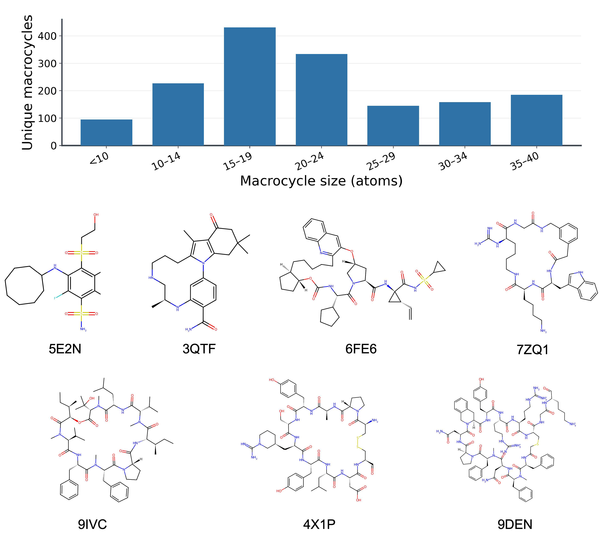

# MacroCycle Dataset: From PDB Structures to a Computation-Ready Benchmark

MacroCycle Dataset is a curated collection of experimentally determined
protein–macrocycle binding modes for evaluating macrocycle conformational
sampling, structure preparation, docking, and related molecular-modelling
methods.



## Release summary

| Item | Value |
| --- | ---: |
| Protein–macrocycle binding-mode cases | 1,861 |
| Unique unprotonated macrocycle structures | 1,570 |
| Unique PDB entries | 1,686 |
| Primary macrocycle size | 8–40 atoms |

This is the first frozen public release. Its acceptance criterion is a genuine,
single-component macrocycle with no known hard error in the unprotonated ligand
structure. The pH 7.4 protonated derivative is supplied for computational
convenience and is not used as an acceptance criterion.

## Repository layout

```text
MacroCycleDataset/
├── README.md
├── LICENSE
├── CITATION.cff
├── benchmark_index.csv
├── assets/
│   └── dataset_overview.jpg
└── cases/
    └── {case_id}/
        ├── protein.pdb
        ├── ligand_unprotonated.sdf
        └── ligand_protonated.sdf
```

## Files in each case

| File | Description |
| --- | --- |
| `protein.pdb` | Protein structure supplied as the experimental binding context, with pocket waters retained where available. |
| `ligand_unprotonated.sdf` | Curated experimental ligand coordinates with audited atom connectivity and bond orders, before pH-dependent protonation. This is the reference ligand structure for benchmark evaluation. |
| `ligand_protonated.sdf` | Computationally prepared pH 7.4 form with explicit hydrogens, generated from the curated unprotonated structure while retaining its heavy-atom coordinates; high-confidence acid/base errors were subsequently audited and corrected. |

Core case metadata and the unprotonated/protonated isomeric SMILES are
consolidated in `benchmark_index.csv`.

## Dataset index

`benchmark_index.csv` is the canonical one-row-per-case index. It contains
exactly 1,861 records and uses relative case identifiers rather than
machine-specific paths.

| Column | Meaning |
| --- | --- |
| `case_id` | Stable case directory name. |
| `pdb_id` | RCSB PDB accession. |
| `resolution_A` | Experimental structure resolution in ångströms, when reported. |
| `structure_title` | Deposited PDB structure title. |
| `publication_doi` | DOI of the associated primary publication, when available. |
| `unprotonated_isomeric_smiles` | Isomeric SMILES derived from the curated reference ligand. |
| `protonated_isomeric_smiles` | Isomeric SMILES for the computationally prepared protonated form. |
| `primary_ring_size` | Number of atoms in the primary macrocycle. Ordinary small rings are not counted as macrocycles. |

Missing source metadata are represented by empty CSV fields rather than
invented values.

## Dataset construction

Macrocycle candidates were collected by screening experimentally determined structures in the RCSB PDB rather than relying only on keywords or ligand annotations. LigandExplorer ([Li et al., 2026](https://doi.org/10.1021/acs.jcim.5c02921)) was used to separate candidate ligands from protein complexes, after which residue- and atom-level connectivity was analyzed to confirm genuine macrocycles, remove non-target or structurally unusable entries, and retain the protein chains representing the observed binding context.

For each accepted case, experimental heavy-atom coordinates were preserved while chemical connectivity and bond orders were reconstructed with Guess Bond Order and checked, where available, against the original PDB/mmCIF record, CCD definitions, deposited instance-coordinate files, and primary literature. The curated unprotonated SDF serves as the structural reference; a pH 7.4 protonated SDF was generated as a computation-ready derivative and audited for high-confidence protonation errors. Automated validation and manual PyMOL review were used to ensure consistency among the ligand structures, SMILES, metadata, and protein–ligand pairing before freezing the release.

## Quick start

Inspect the index:

```python
import pandas as pd

index = pd.read_csv("benchmark_index.csv")
print(index.shape)                 # (1861, 8)
print(index.primary_ring_size.describe())
```

Load a reference ligand with RDKit:

```python
from pathlib import Path
from rdkit import Chem

case_id = "10hy__Ligand_organic_A1C5F_A_301"
path = Path("cases") / case_id / "ligand_unprotonated.sdf"
mol = Chem.SDMolSupplier(str(path), removeHs=False)[0]
assert mol is not None
```

## Citation

Please cite this release using the metadata in `CITATION.cff` and cite the
original experimental structure publications through the DOI information in
`benchmark_index.csv` whenever individual cases are discussed.

## License and source attribution

The benchmark compilation, curation, index, documentation, and original figure
are distributed under CC BY 4.0. Structural data derived from the PDB archive
remain available under the wwPDB/RCSB PDB CC0 policy. See `LICENSE` for details.

- RCSB PDB usage policy: https://www.rcsb.org/pages/usage-policy
- CC BY 4.0: https://creativecommons.org/licenses/by/4.0/

The data are provided without warranty. Users remain responsible for checking
fitness for their intended scientific application.
