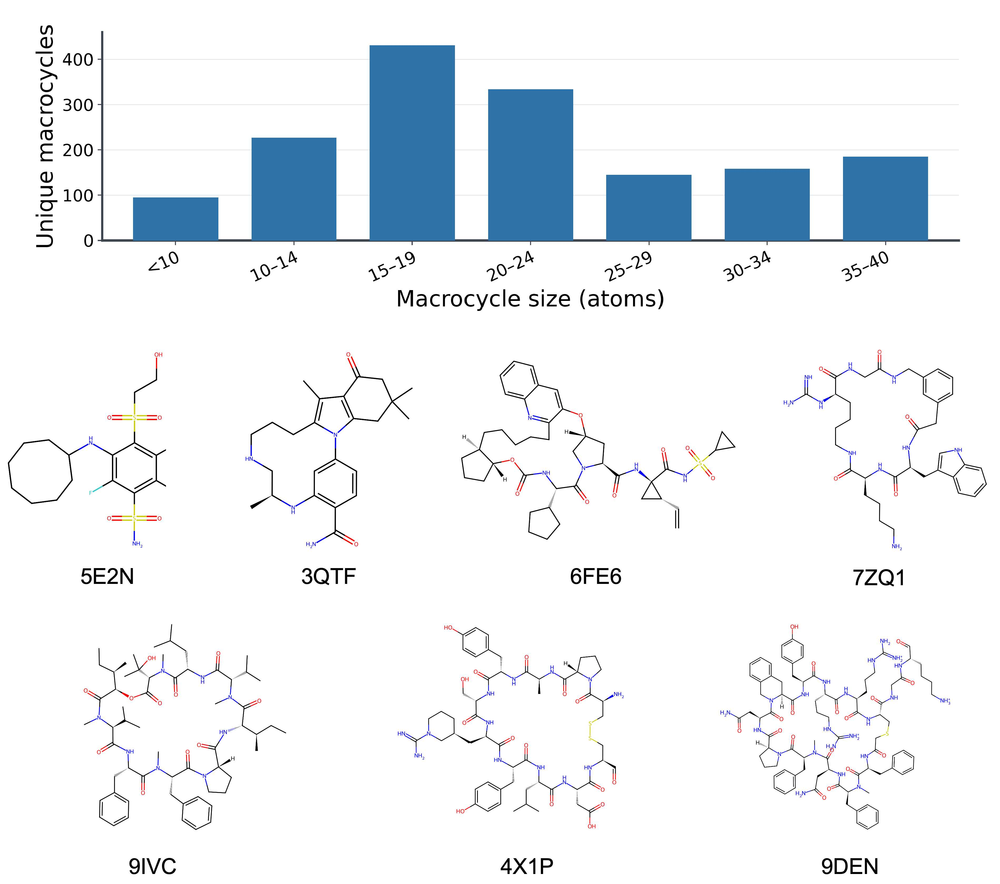
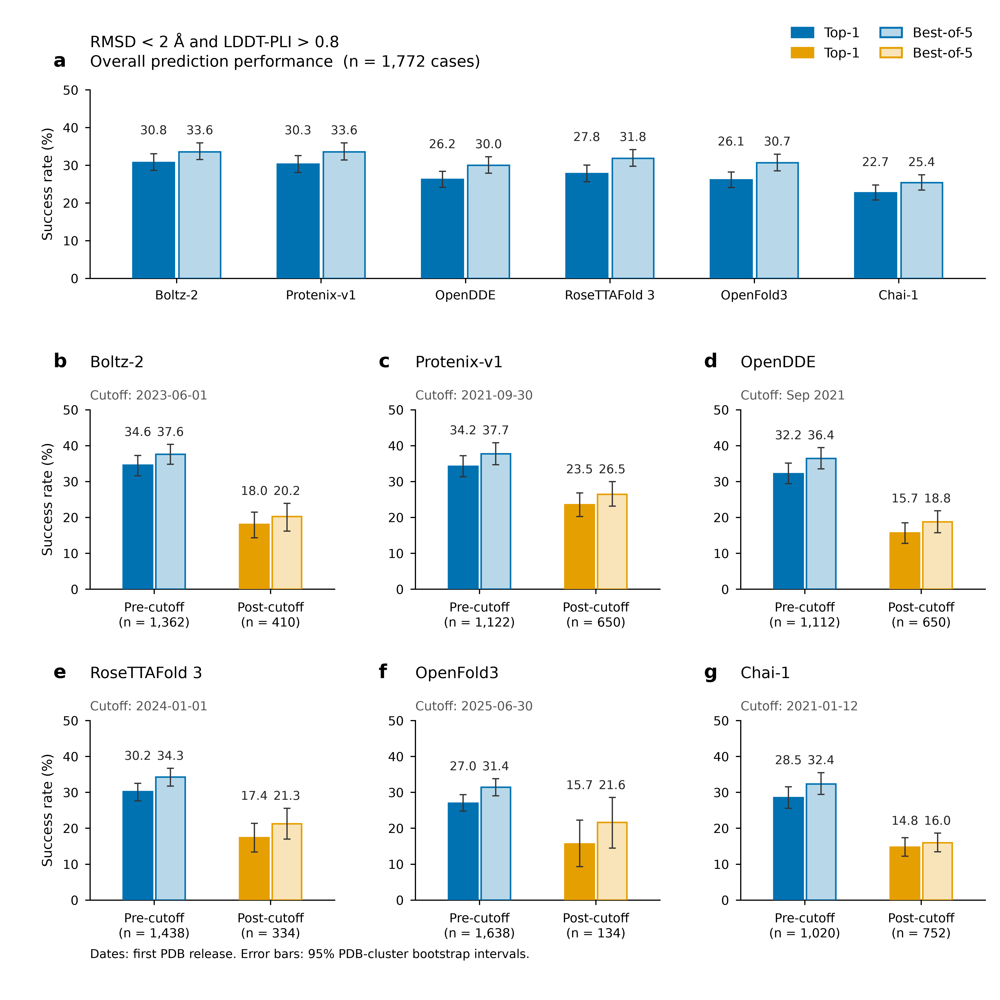

# MacroCycle-Benchmark: A Protein–Macrocycle Structure Dataset and Cofolding Benchmark

English | [简体中文](README-zh.md)

MacroCycle-Benchmark is a curated dataset of experimentally determined protein–macrocycle structures from the Protein Data Bank (PDB), covering cyclic peptides and nonpeptidic macrocycles. Through ligand chemical structure reconstruction, cross-checking against reference information, and case-by-case manual inspection, we link complete macrocycle chemical structures to their experimental bound conformations and protein environments. The dataset provides experimental references for developing and evaluating macrocycle conformational sampling, docking, and cofolding methods.

Using this dataset, we evaluated six general-purpose cofolding models, focusing on their generalization to novel protein–macrocycle binding modes and the relationships between prediction performance, input representation, ring size, and similarity to historical structures.

**Paper:** [Evaluating cofolding methods for protein–macrocycle structure prediction](https://doi.org/10.26434/chemrxiv.15012755/v1) · ChemRxiv, 2026

## Updates

- **2026-11-25:** The research preprint was released on ChemRxiv.
- The dataset and case index are publicly available. The index includes PDB release dates, main-ring size groups, and subset labels for sequence-input analyses.

## Dataset overview

| Item | Count or range |
|---|---:|
| Protein–macrocycle binding cases | 1,861 |
| Source PDB entries | 1,686 |
| Unique macrocyclic ligands | 1,570 |
| Main-ring size | 8–40 atoms |
| Sequence-input candidate subset | 628 |
| Standard-amino-acid cyclic peptide analysis subset | 74 |
| Common cases evaluated across six models in the paper | 1,772 |

Each case includes a protein structure, a chemically verified experimental macrocycle structure, and a protonated ligand structure prepared at a reference pH of 7.4.

Dataset curation comprises three steps:

1. **Extraction and screening.** Candidate ligands are extracted from experimental PDB complexes using [LigandExplorer](https://doi.org/10.1021/acs.jcim.5c02921), developed by our group. Atomic connectivity is used to identify macrocycles and exclude structures that do not meet the inclusion criteria.
2. **Chemical structure reconstruction and verification.** Ligand connectivity, bond orders, interresidue linkages, and ring-closure bonds are reconstructed and verified while preserving experimental heavy-atom coordinates. Corrections draw on Chemical Component Dictionary (CCD) definitions, PDB/mmCIF records, and available literature.
3. **Structure preparation and quality checks.** Protonated structures are generated, redundant cases are removed, and automated checks and case-by-case manual review are performed to verify ligand structures, SMILES, metadata, and protein–ligand pairing.



Main-ring size distribution of unique macrocyclic ligands and representative chemical structures.

## Cofolding model evaluation

The table below reports the results for six models on the **1,772 common cases** evaluated in the paper. All models received ligand **SMILES** as input, with five candidate structures evaluated per case.

| Model | Top-1 success rate (%) | Best-of-5 success rate (%) |
|---|---:|---:|
| Boltz-2 | 30.8 | 33.6 |
| Protenix-v1 | 30.3 | 33.6 |
| OpenDDE | 26.2 | 30.0 |
| RoseTTAFold 3 | 27.8 | 31.8 |
| OpenFold3 | 26.1 | 30.7 |
| Chai-1 | 22.7 | 25.4 |

**Success criteria:** The same candidate must achieve both a ligand heavy-atom RMSD <2 Å after binding-site superposition and a protein–ligand interface LDDT score (LDDT-PLI) >0.8.

- **Top-1:** The candidate ranked first by the model's native confidence score.
- **Best-of-5:** At least one of the five candidates meets both success criteria. This metric uses the experimental structure to assess the success coverage of the candidate set.

These results correspond to the model versions and inference settings evaluated in the paper. See the paper for the full configurations and statistical methods.



Figure 1 from the paper: overall performance of six models and performance before and after their respective training cutoffs. Error bars indicate 95% confidence intervals from bootstrap resampling clustered by PDB entry.

### Key findings

- **Performance declines after training cutoffs.** All six models had lower Top-1 success rates on cases released after their respective training cutoffs than on earlier cases, with decreases of 10.7–16.5 percentage points.
- **Cases with low historical similarity are harder to predict.** Among post-cutoff cases with assessable historical similarity, success rates were below 8% for all six models in the lowest-similarity group. Historical references were experimental structures in the benchmark released before the corresponding cutoff.
- **Sequence input improves prediction for some cyclic peptides.** In paired comparisons within each model, Boltz-2 and RoseTTAFold 3 achieved more confirmed successes with sequence input than with SMILES input, although post-cutoff performance remained lower.
- **Large-ring failures involve the ligand conformation itself.** For 30–40-membered rings, 97.5–100% of failed SMILES-based Top-1 predictions across models still had a ligand heavy-atom RMSD of at least 2 Å after ligand-only superposition.

These results indicate that current models remain limited in their ability to generalize to novel macrocycle binding modes. Assessing progress requires examining performance on cases with low historical similarity and across ring sizes, alongside overall success rates.

## Quick start

Clone the repository:

```bash
git clone https://github.com/dptech-corp/MacroCycle-Benchmark.git
cd MacroCycle-Benchmark
```

The examples below require `pandas` and `RDKit`, respectively.

**Read the index and select subsets:**

```python
import pandas as pd

index = pd.read_csv("benchmark_index.csv")
print(index.shape)  # (1861, 12)

# Sequence-input candidate subset
sequence_cases = index[index["sequence_set"] == 1]

# Standard-amino-acid cyclic peptide subset analyzed in the paper
standard_cases = index[index["standard_amino_acid_subset"] == 1]

# Cases with 30–40 atoms in the main ring
large_ring_cases = index[index["primary_ring_size"].between(30, 40)]
```

**Load an experimental reference ligand:**

```python
from pathlib import Path
from rdkit import Chem

case_id = index.iloc[0]["case_id"]
ligand_path = Path("cases") / case_id / "ligand_unprotonated.sdf"

ligand = Chem.SDMolSupplier(str(ligand_path), removeHs=False)[0]
assert ligand is not None
```

The PDB and SDF files in this repository contain experimental coordinates. When evaluating cofolding predictions from sequences and chemical structures, use these coordinates for evaluation and avoid supplying the experimental binding pose as a prediction input.

## Repository layout

```text
MacroCycle-Benchmark/
├── README.md
├── README-zh.md
├── LICENSE
├── CITATION.cff
├── benchmark_index.csv
├── assets/
│   ├── dataset_overview.jpg
│   └── figure1.png
└── cases/
    └── {case_id}/
        ├── protein.pdb
        ├── ligand_unprotonated.sdf
        └── ligand_protonated.sdf
```

| File | Contents |
|---|---|
| `benchmark_index.csv` | One row per case, containing structural metadata, SMILES, and subset labels. |
| `protein.pdb` | Experimental protein environment, with pocket waters retained where available. |
| `ligand_unprotonated.sdf` | Curated experimental reference ligand structure before pH-dependent protonation. |
| `ligand_protonated.sdf` | Ligand structure prepared at a reference pH of 7.4 with explicit hydrogens, retaining experimental heavy-atom coordinates. |

## Index fields

| Field | Description |
|---|---|
| `case_id` | Unique case identifier matching the directory name under `cases/`. |
| `pdb_id` | Source PDB accession. |
| `resolution_A` | Experimental structure resolution in ångströms; empty if not reported. |
| `structure_title` | Deposited PDB structure title. |
| `publication_doi` | DOI of the associated primary publication; empty if unavailable. |
| `unprotonated_isomeric_smiles` | Isomeric SMILES of the curated reference ligand. |
| `protonated_isomeric_smiles` | Isomeric SMILES of the ligand after protonation-state preparation. |
| `primary_ring_size` | Number of atoms in the main ring. |
| `pdb_release_date` | Initial public release date of the PDB entry, in `YYYY-MM-DD` format. |
| `ring_size_bin` | Main-ring size group: `<10`, `10–14`, `15–19`, `20–24`, `25–29`, `30–34`, or `35–40`. |
| `sequence_set` | Membership of the 628-case sequence-input candidate subset: `1` if included, otherwise `0`. |
| `standard_amino_acid_subset` | Membership of the 74-case standard-amino-acid cyclic peptide analysis subset used in the paper: `1` if included, otherwise `0`. |

## Feedback and participation

Please use [GitHub Issues](https://github.com/dptech-corp/MacroCycle-Benchmark/issues) to report data issues or discuss model evaluation. For issues involving a specific structure, include the `case_id`, a description of the problem, and supporting evidence.

The repository currently provides the dataset and baseline results from the paper. Submission formats and a standardized evaluation workflow for additional models will be announced once finalized.

## Citation

If you use the dataset or evaluation results, please cite the following paper. Dataset version metadata are available in `CITATION.cff`.

> Yang, Y., Wang, Z., Zhang, W., Zheng, H. & Zou, R. Evaluating cofolding methods for protein–macrocycle structure prediction. *ChemRxiv* (2026). [doi:10.26434/chemrxiv.15012755/v1](https://doi.org/10.26434/chemrxiv.15012755/v1)

## License and source attribution

The dataset compilation and curation, index, documentation, and original figure are distributed under **CC BY 4.0**; see `LICENSE`. Structural data derived from the PDB archive remain subject to the wwPDB/RCSB PDB **CC0** policy.

- [CC BY 4.0](https://creativecommons.org/licenses/by/4.0/)
- [RCSB PDB usage policy](https://www.rcsb.org/pages/usage-policy)
